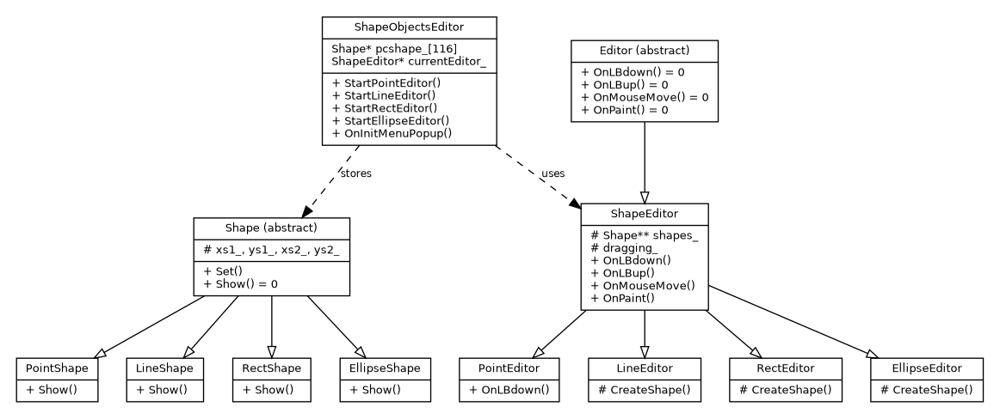

<div style="text-align:center">

**Міністерство освіти і науки України**  
**Національний технічний університет України**  
**«Київський політехнічний інститут імені Ігоря Сікорського»**  
**Факультет інформатики та обчислювальної техніки**  
**Кафедра обчислювальної техніки**

<br><br><br>

# Лабораторна робота №2
## з дисципліни «Об'єктно-орієнтоване програмування»
### на тему
## «Розробка графічного редактора об'єктів на C++»

</div>

<br><br>

<div style="text-align:right">

**Виконав:**  
Чакун Олександр Сергійович  
студент групи ІМ-о51  
номер у списку: 16

**Перевірив:**  
Рекечинський Дмитро Олександрович

</div>

<br><br><br>

<div style="text-align:center">Київ 2026</div>

---

# 1. Мета роботи

Отримати практичні навички використання інкапсуляції, абстракції типів, успадкування та поліморфізму на основі класів C++ шляхом створення простого графічного редактора в об'єктно-орієнтованому стилі.

# 2. Завдання

Створити Windows Desktop Application `Lab2`, реалізувати графічний редактор для об'єктів «Крапка», «Лінія», «Прямокутник» та «Еліпс», використовуючи ієрархії класів `Shape` та `Editor`, поліморфний виклик методів та модуль `shape_editor`.

# 3. Варіант завдання

Номер у журналі:

```text
Ж = 16
```

Розрахунок параметрів:

```text
16 mod 3 = 1
N = 16 + 100 = 116
16 mod 4 = 0
16 mod 2 = 0
16 mod 5 = 1
16 mod 6 = 4
```

Отже:

- масив вказівників `Shape*` — **статичний**, 116 елементів;
- «гумовий» слід — **суцільна чорна лінія**;
- прямокутник вводиться **по двох протилежних кутах**;
- прямокутник має **чорний контур і кольорове заповнення**;
- колір заповнення прямокутника — **помаранчевий `RGB(255,128,0)`**;
- еліпс вводиться **від центра до одного з кутів охоплюючого прямокутника**;
- еліпс має **чорний контур і біле заповнення**;
- поточний тип об'єкта позначається **у меню** методом `OnInitMenuPopup`.

# 4. Структура програми

```text
Lab2.cpp
└── shape_editor.h
    └── shape_editor.cpp
        ├── editor.h / editor.cpp
        ├── shape.h / shape.cpp
        └── resource.h

Lab2.rc → resource.h
```

Модуль `shape_editor` є інтерфейсом між головним вікном та ієрархією редакторів. Події миші з `WndProc` передаються об'єкту `ShapeObjectsEditor`, який поліморфно викликає методи поточного редактора.

# 5. Діаграма класів



# 6. Основні фрагменти вихідного коду

## 6.1. Обробка повідомлень у Lab2.cpp

```cpp
case WM_LBUTTONDOWN:
    g_editor.OnLBdown(hWnd);
    return 0;
case WM_LBUTTONUP:
    g_editor.OnLBup(hWnd);
    return 0;
case WM_MOUSEMOVE:
    g_editor.OnMouseMove(hWnd);
    return 0;
case WM_PAINT:
    g_editor.OnPaint(hWnd);
    return 0;
case WM_INITMENUPOPUP:
    g_editor.OnInitMenuPopup(hWnd, wParam);
    return 0;
```

## 6.2. Абстрактний клас Shape

```cpp
class Shape
{
protected:
    long xs1_, ys1_, xs2_, ys2_;
public:
    virtual ~Shape() = default;
    void Set(long x1, long y1, long x2, long y2);
    virtual void Show(HDC hdc) const = 0;
};
```

Від `Shape` успадковуються `PointShape`, `LineShape`, `RectShape` та `EllipseShape`. Метод `Show` є віртуальним, тому відображення збережених фігур виконується поліморфно.

## 6.3. Абстрактний клас Editor

```cpp
class Editor
{
public:
    virtual ~Editor() = default;
    virtual void OnLBdown(HWND hWnd) = 0;
    virtual void OnLBup(HWND hWnd) = 0;
    virtual void OnMouseMove(HWND hWnd) = 0;
    virtual void OnPaint(HWND hWnd) = 0;
};
```

Від `Editor` успадковується `ShapeEditor`, а від нього — конкретні редактори `PointEditor`, `LineEditor`, `RectEditor`, `EllipseEditor`.

## 6.4. Статичний масив об'єктів

```cpp
static constexpr int kMaxShapes = 116;
Shape* pcshape_[kMaxShapes]{};
```

Для Ж = 16 використовується статичний масив на 116 вказівників.

## 6.5. «Гумовий» слід

```cpp
const int oldRop = SetROP2(hdc, R2_NOTXORPEN);
HPEN pen = CreatePen(PS_SOLID, 1, RGB(0, 0, 0));
```

Слід малюється суцільною чорною лінією. Режим `R2_NOTXORPEN` дозволяє повторним малюванням стерти попередню позицію без руйнування вже намальованих об'єктів.

## 6.6. Прямокутник

```cpp
HBRUSH brush = CreateSolidBrush(RGB(255, 128, 0));
Rectangle(hdc, r.left, r.top, r.right, r.bottom);
```

Прямокутник вводиться двома протилежними кутами та відображається з чорним контуром і помаранчевим заповненням.

## 6.7. Еліпс

Початкова точка трактується як центр. За відхиленням курсора визначаються півосі та координати охоплюючого прямокутника. Еліпс відображається з чорним контуром і білим заповненням.

## 6.8. Позначка поточного режиму

```cpp
CheckMenuItem(hObjectsMenu, currentCommand_, MF_BYCOMMAND | MF_CHECKED);
```

Метод `OnInitMenuPopup` знімає попередні позначки та ставить позначку біля активного типу об'єкта.

# 7. Ілюстрації роботи програми

Після запуску програми у Visual Studio до фінального PDF необхідно додати реальні скріншоти:

1. головне вікно та меню `Об'єкти` з позначеним активним режимом;
2. процес введення лінії з «гумовим» слідом;
3. намальований помаранчевий прямокутник;
4. намальований еліпс з білим заповненням;
5. фінальне вікно з кількома об'єктами;
6. вікно `Про програму`.

# 8. Висновки

У лабораторній роботі створено простий графічний редактор об'єктів на C++ та Win32 API. Реалізовано дві ієрархії класів, абстрактні базові класи, успадкування, віртуальні методи та поліморфний виклик обробників. Для збереження об'єктів використано статичний масив із 116 вказівників `Shape*`. Реалізовано чотири типи графічних об'єктів, «гумовий» слід відповідно до індивідуального варіанту та позначення активного режиму у меню.
