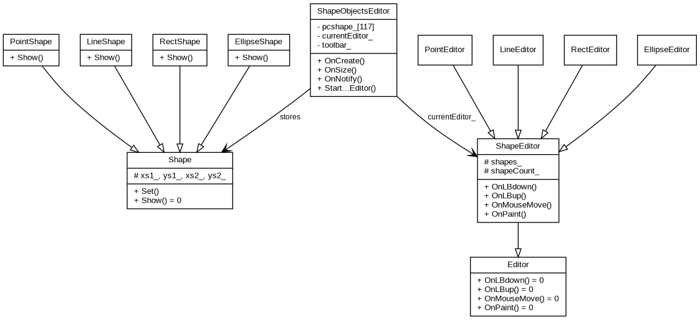

<div style="text-align:center">

**Міністерство освіти і науки України**  
**Національний технічний університет України**  
**«Київський політехнічний інститут імені Ігоря Сікорського»**  
**Факультет інформатики та обчислювальної техніки**  
**Кафедра обчислювальної техніки**

<br><br><br>

# Лабораторна робота №3
## з дисципліни «Об'єктно-орієнтоване програмування»
### на тему
## «Розробка інтерфейсу користувача на C++»

</div>

<br><br>

<div style="text-align:right">

**Виконав:**  
Чакун Олександр Сергійович  
студент групи ІМ-о51  
номер у списку: 16

**Перевірив:**  
Рекечинський Дмитро Олександрович

</div>

<br><br><br>
<div style="text-align:center">Київ 2026</div>

---

# 1. Мета роботи

Отримати практичні навички створення графічного інтерфейсу користувача на C++ у середовищі Windows із використанням класів, успадкування, поліморфізму, меню, Toolbar та підказок для кнопок.

# 2. Завдання

Створити Win32-проєкт `Lab3`, продовживши графічний редактор попередньої лабораторної роботи. Додати Toolbar з кнопками для вибору типу об'єкта, дублювання пунктів меню та tooltips. Обробники повідомлень, зокрема `OnNotify`, реалізувати як методи класу.

# 3. Варіант

Для Lab3:

```text
Ж = Жлаб2 + 1 = 16 + 1 = 17
N = 17 + 100 = 117
17 mod 3 = 2
17 mod 4 = 1
17 mod 2 = 1
17 mod 5 = 2
17 mod 6 = 5
```

Отже:
- масив `Shape*` — статичний, 117 елементів;
- «гумовий» слід — суцільний червоний;
- прямокутник вводиться від центра до кута, має чорний контур і сіре заповнення;
- еліпс вводиться по двох протилежних кутах та відображається без заповнення;
- активний режим показується у заголовку вікна;
- Toolbar містить 4 кнопки з підказками.

# 4. Структура програми

```text
Lab3.cpp
└── shape_editor.h / shape_editor.cpp
    ├── editor.h / editor.cpp
    ├── shape.h / shape.cpp
    └── resource.h

Lab3.rc → resource.h + toolbar.bmp
```

# 5. Діаграма класів



# 6. Основні фрагменти реалізації

## 6.1. Toolbar

`ShapeObjectsEditor::OnCreate` створює дочірнє вікно `Toolbar`. Чотири кнопки відповідають типам «Крапка», «Лінія», «Прямокутник», «Еліпс» та мають ті самі ID, що й відповідні пункти меню.

## 6.2. Підказки

Повідомлення `WM_NOTIFY` передається у метод `ShapeObjectsEditor::OnNotify`, де для кожної кнопки задається текст підказки.

## 6.3. Зміна розміру

Повідомлення `WM_SIZE` передається в `OnSize`, який викликає `TB_AUTOSIZE`, щоб Toolbar правильно підлаштовувався під ширину головного вікна.

## 6.4. Поліморфізм

Клас `Shape` має чисто віртуальний метод `Show`, а клас `Editor` — віртуальні методи обробки миші та відображення. Конкретні класи перевизначають ці методи.

## 6.5. Варіант Ж = 17

Для тимчасового «гумового» сліду створюється червоне суцільне перо:

```cpp
HPEN pen = CreatePen(PS_SOLID, 1, RGB(255, 0, 0));
```

Прямокутник формується від центра до кута і відображається із сірим заповненням `RGB(192,192,192)`. Еліпс формується двома протилежними кутами та малюється з `HOLLOW_BRUSH`.

# 7. Ілюстрації

До фінального PDF після запуску програми потрібно вставити реальні скріншоти з папки `screenshots/`: головне вікно, меню, tooltip, приклади чотирьох типів фігур, червоний гумовий слід та вікно «Про програму».

# 8. Висновки

У лабораторній роботі графічний редактор доповнено інтерфейсом Toolbar. Реалізовано дублювання команд меню кнопками, підказки через `WM_NOTIFY`, автоматичне підлаштування Toolbar при `WM_SIZE`, а також індивідуальні параметри варіанта Ж=17. Збережено об'єктно-орієнтовану структуру з абстрактними базовими класами, успадкуванням і поліморфізмом.
