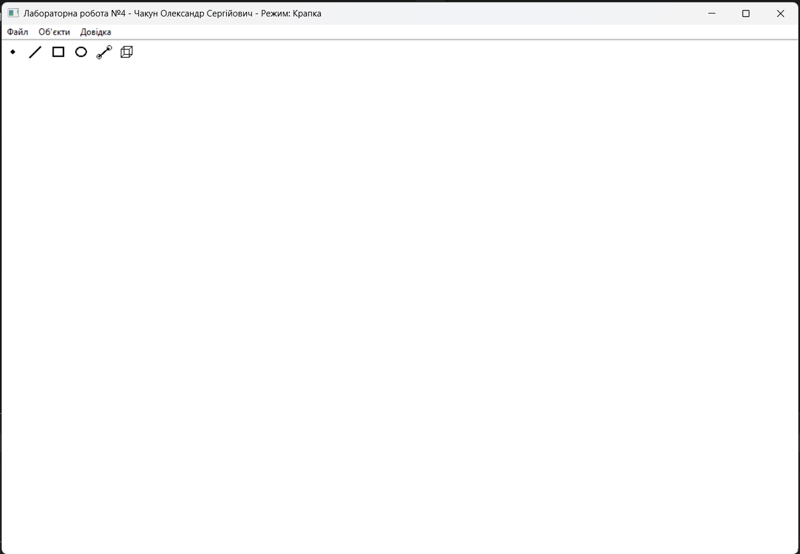
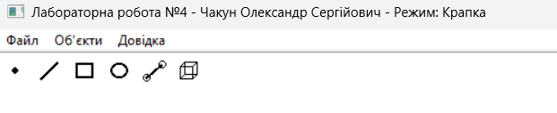
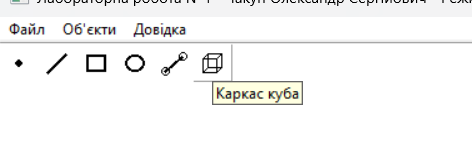
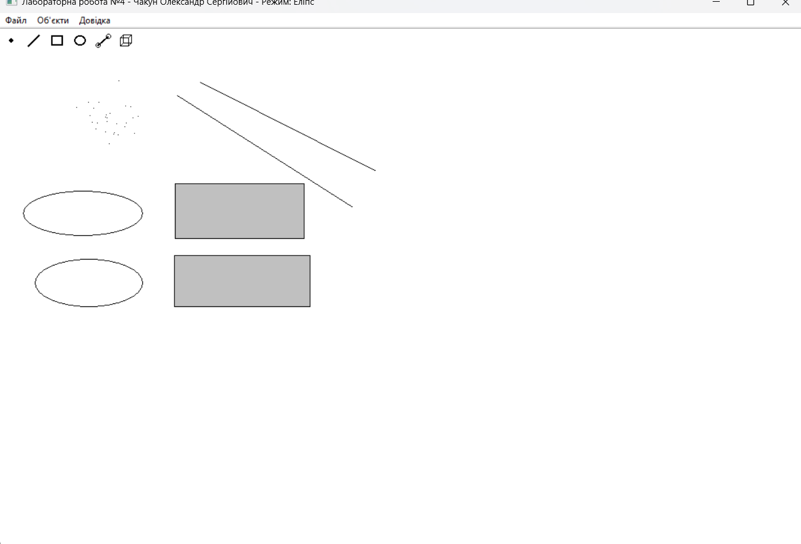
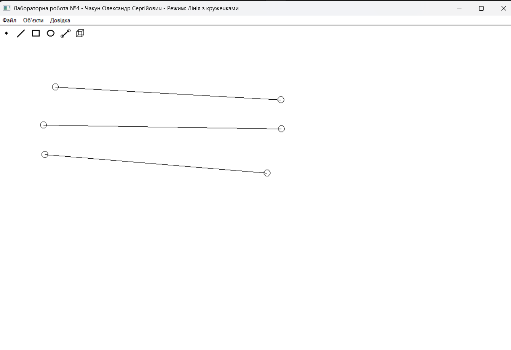
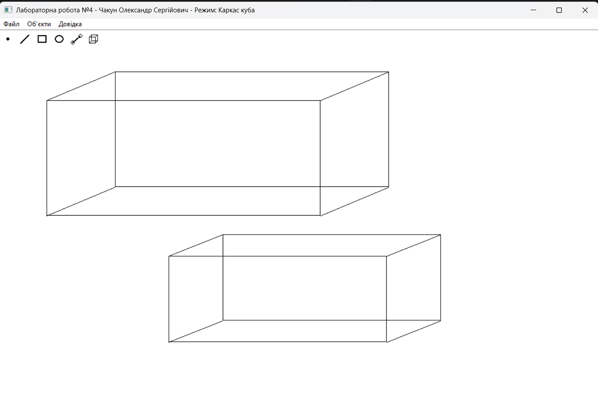
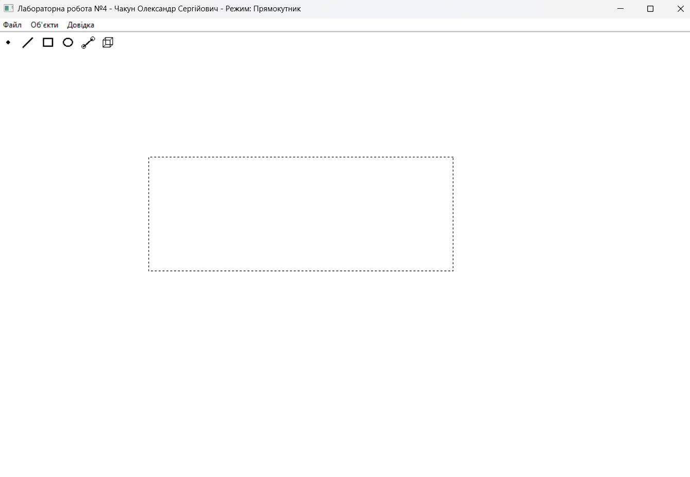
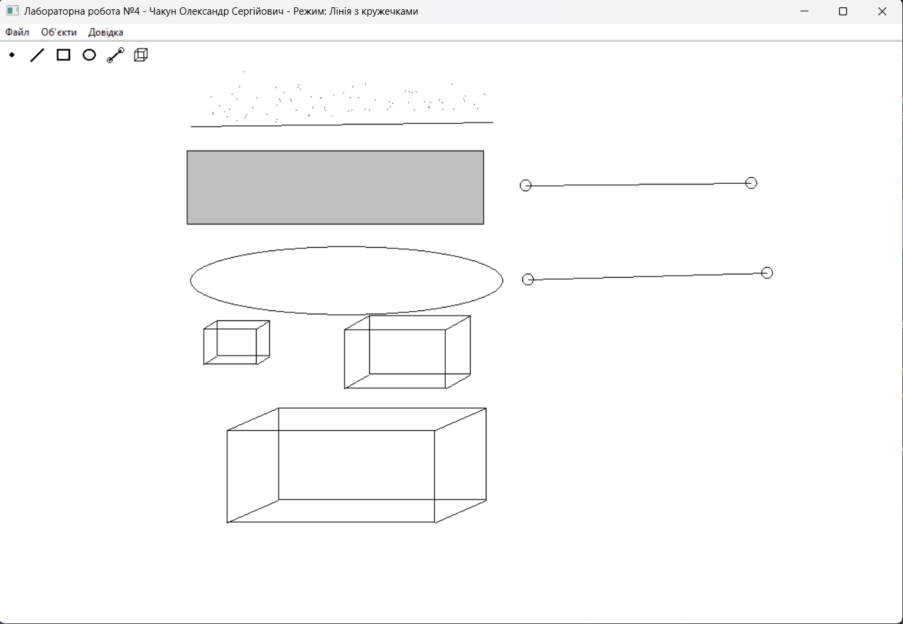

# Лабораторна робота №4
## Вдосконалення структури коду графічного редактора об’єктів на C++

**Студент:** Чакун Олександр Сергійович  
**Група:** ІМ-о51  
**Номер у списку / варіант:** 16  
**Дисципліна:** Об’єктно-орієнтоване програмування

## 1. Мета роботи

Отримати практичні навички проєктування класів та рефакторингу об’єктно-орієнтованої програми, зменшити залежність редактора від конкретних типів фігур, реалізувати динамічне керування об’єктами та множинне успадкування.

## 2. Варіант

- Варіант: **16**.
- Для парного номера використовується **динамічний об’єкт `MyEditor`**.
- Гумовий слід усіх фігур - **пунктирний**.
- Додано `LineOOShape` і `CubeShape` через **множинне успадкування**.
- Toolbar містить **6 кнопок** з tooltips.

## 3. Рефакторинг

Замість окремих методів запуску для кожного типу фігури використовується універсальний метод:

```cpp
void MyEditor::Start(Shape* shape);
```

`MyEditor` працює через абстрактний `Shape`, тому нові типи можна додавати без введення нового `Start...Editor` у сам редактор.

## 4. Динамічний MyEditor

```cpp
static MyEditor* g_editor = nullptr;

case WM_CREATE:
    g_editor = new MyEditor();
    break;

case WM_DESTROY:
    delete g_editor;
    g_editor = nullptr;
    break;
```

## 5. Множинне успадкування

```cpp
class LineOOShape : public LineShape, public EllipseShape;
class CubeShape : public LineShape, public RectShape;
```

Для уникнення дублювання `Shape` у ромбічній ієрархії `LineShape`, `RectShape` та `EllipseShape` використовують `virtual public Shape`.

## 6. Діаграма класів


## 7. Результати роботи

### Головне вікно


### Toolbar


### Tooltip


### Базові фігури


### LineOOShape


### CubeShape


### Пунктирний гумовий слід


### Усі фігури


## 8. Висновки

У Lab4 виконано рефакторинг архітектури графічного редактора. `MyEditor` залежить від абстракції `Shape`, використовує універсальний метод `Start(Shape*)`, динамічний масив фігур і коректне динамічне створення/знищення для варіанта №16. Нові типи `LineOOShape` і `CubeShape` реалізовано множинним успадкуванням. Toolbar має шість кнопок з підказками, а гумовий слід відображається пунктирною лінією.
