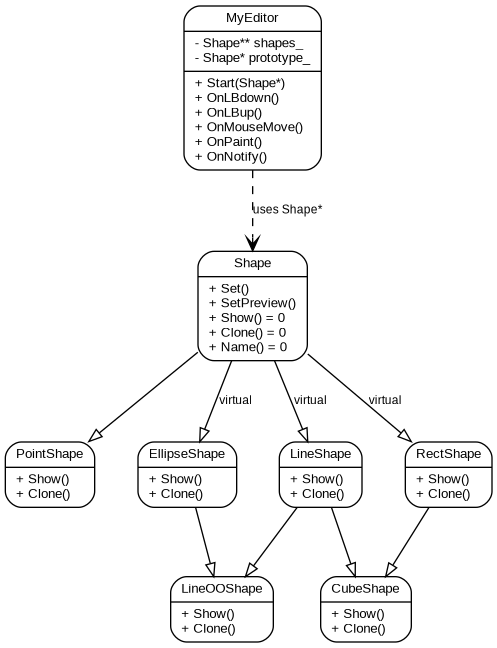

# Лабораторна робота №4
## Вдосконалення структури коду графічного редактора об’єктів на C++

**Студент:** Чакун Олександр Сергійович  
**Група:** ІМ-о51  
**Номер у списку / варіант:** 16

---

# 1. Мета роботи

Отримати практичні навички проєктування класів, рефакторингу, залежності від абстракції, динамічного керування об'єктами та множинного успадкування.

# 2. Варіант

Номер варіанта: **16**.

Оскільки номер парний, використовується динамічний об'єкт `MyEditor`.

Кольори та стилі чотирьох базових фігур збережені як у Lab3:
- прямокутник — сіре заповнення;
- еліпс — без заповнення;
- лінія та точка — чорні.

Для всіх фігур «гумовий» слід — пунктирний.

Додано:
- `LineOOShape` — лінія з кружечками;
- `CubeShape` — каркас куба.

# 3. Основна ідея рефакторингу

Замість набору методів `StartPointEditor`, `StartLineEditor`, `StartRectEditor` тощо використано один універсальний метод:

```cpp
void MyEditor::Start(Shape* shape);
```

`MyEditor` працює через абстрактний клас `Shape`, тому нові типи фігур можна додавати без переписування самого класу редактора.

# 4. Динамічний MyEditor

```cpp
static MyEditor* g_editor = nullptr;
```

Створення:

```cpp
case WM_CREATE:
    g_editor = new MyEditor();
```

Знищення:

```cpp
case WM_DESTROY:
    delete g_editor;
    g_editor = nullptr;
```

# 5. Динамічний масив Shape**

Масив створюється лише тоді, коли потрібно зберегти першу фігуру, і автоматично розширюється.

# 6. Множинне успадкування

```cpp
class LineOOShape : public LineShape, public EllipseShape
```

```cpp
class CubeShape : public LineShape, public RectShape
```

Для коректного спільного базового класу `Shape` використано virtual inheritance:

```cpp
class LineShape : virtual public Shape
class RectShape : virtual public Shape
class EllipseShape : virtual public Shape
```

# 7. Діаграма класів



# 8. Toolbar

Toolbar містить 6 кнопок:
1. Крапка
2. Лінія
3. Прямокутник
4. Еліпс
5. Лінія з кружечками
6. Каркас куба

Усі кнопки мають tooltips.

# 9. Ілюстрації

До фінального звіту після запуску програми вставити:
- головне вікно;
- Toolbar з 6 кнопками;
- tooltip нової кнопки;
- усі 6 типів фігур;
- пунктирний «гумовий» слід;
- вікно «Про програму».

# 10. Висновки

У Lab4 виконано рефакторинг архітектури графічного редактора. `MyEditor` тепер залежить від абстракції `Shape`, використовує динамічний масив об'єктів і підтримує додавання нових типів через спільний метод `Start(Shape*)`. Нові фігури реалізовані через множинне успадкування, а virtual inheritance запобігає дублюванню базового класу `Shape`.
