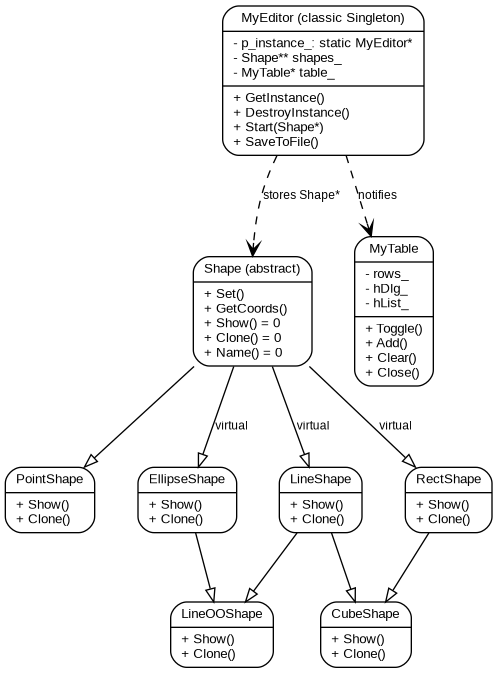
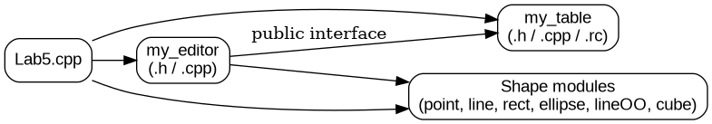

# Лабораторна робота №5
## Розробка багатовіконного інтерфейсу користувача для графічного редактора об'єктів

**Студент:** Чакун Олександр Сергійович  
**Група:** ІМ-о51  
**Номер у списку / варіант:** 16  
**Дисципліна:** Об'єктно-орієнтоване програмування

## 1. Мета роботи

Отримати практичні навички програмування багатовіконного інтерфейсу на C++ в об'єктно-орієнтованому стилі, реалізувати Singleton для головного редактора, незалежний модуль немодальної таблиці та збереження описів графічних об'єктів у текстовому файлі.

## 2. Варіант

- Варіант: **16**.
- Для парного номера використовується **класичний Singleton `MyEditor`**.
- Геометричні фігури та їх стилі успадковані з Lab4.
- Таблиця реалізована окремим класом `MyTable` у незалежному модулі.
- Кожний об'єкт автоматично записується у файл `objects.txt`.

## 3. Класичний Singleton

```cpp
MyEditor* MyEditor::p_instance_ = nullptr;

MyEditor* MyEditor::GetInstance()
{
    if (p_instance_ == nullptr)
        p_instance_ = new MyEditor();
    return p_instance_;
}
```

Конструктор `MyEditor` закритий, а копіювання заборонене. Це гарантує існування тільки одного головного редактора.

## 4. Немодальне вікно таблиці

Модуль `my_table` складається з `my_table.h`, `my_table.cpp`, `my_table_resources.h` і `my_table.rc`. Він не використовує заголовки фігур або редактора.

Таблиця створюється через `CreateDialogParamW`, тому не блокує головне вікно. Рядок містить п'ять полів: назву та координати `x1`, `y1`, `x2`, `y2`.

## 5. Запис у файл

Після додавання фігури `MyEditor::AddShape` автоматично передає дані у `MyTable::Add` і додає рядок у `objects.txt`.

Формат:

```text
Назва<TAB>x1<TAB>y1<TAB>x2<TAB>y2
```

## 6. Діаграма класів



## 7. Залежності модулів



## 8. Результати роботи

Після запуску потрібно додати скріншоти:
- головне вікно;
- головне вікно разом із немодальною таблицею;
- таблиця з кількома рядками;
- прокрутка таблиці;
- файл `objects.txt`;
- усі шість фігур.

## 9. Висновки

У Lab5 реалізовано багатовіконний графічний редактор. `MyEditor` працює як класичний Singleton для варіанта №16. Незалежний клас `MyTable` підтримує немодальне вікно зі списком створених фігур. Після створення кожного об'єкта його опис автоматично додається до таблиці та текстового файлу. Збережено поліморфну архітектуру фігур і Toolbar із шістьма режимами.
